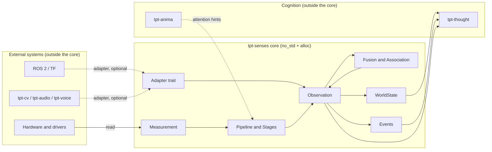

# tpt-senses — Design

This document records the design decisions behind the crate. The full specification is in
[`spec.txt`](spec.txt); section references (§n) point into it. [`todo.md`](todo.md) tracks what is
done.

## Layered model (§3, §6)

```
REALITY → SENSOR → measurement → PERCEPTION → observation → tpt-senses → world state → cognition
```

- **Measurement**: raw or minimally processed sensor output, with timestamp and provenance.
- **Observation**: a semantic interpretation of one or more measurements, with confidence.
- **Cognition** reasons about observations. It never needs to know the hardware.

## Relationships (§6, §54)



Solid arrows are the core's own data flow. Dashed arrows are adapter or hint paths that depend on
the integrating system. Cognition only ever receives observations, world state and events. It never
receives hardware types.

## Module map

| Area | Module(s) | Spec |
|---|---|---|
| Identity | `id` | §50 |
| Time | `timestamp`, `temporal` | §17 |
| Modality | `modality` | §11, §52 |
| Values | `measurement` | §12 |
| Quality | `uncertainty`, `trust` | §15, §33 |
| Lineage | `provenance`, `calibration` | §16, §30, §32 |
| Observations | `observation` | §13, §14, §34 |
| Health | `health` | §31 |
| Capability | `capability`, `profile` | §5, §10, §24, §25 |
| Sensor | `sensor`, `adapter` | §9, §7, §54 |
| Streams | `stream`, `record` | §27, §28, §29 |
| Space | `spatial` | §18 |
| Events | `event` | §21 |
| Perception | `pipeline`, `fusion`, `entity`, `world` | §19, §20, §22, §26 |
| Internal sensing | `internal` | §23 |
| Control | `control` | §35–§37 |

## Core types

| Concern | Types | Notes |
|---|---|---|
| Identity | `SensorId`, `MeasurementId`, `ObservationId`, `EntityId` | `u64` newtypes; no UUID dependency |
| Time | `Timestamp`, `Duration`, `Frequency`, `ClockSource`, `TimingInfo` | Timestamps from different clocks are *incomparable* (`partial_cmp` → `None`) |
| Modality | `Modality` | Extensible; `Custom(..)` for modalities not yet defined (§11) |
| Values | `MeasurementValue`, `SharedBuffer` | Scalar, vector, matrix, image, audio, point cloud, spectrum, categorical, structured, binary |
| Quality | `Confidence`, `Precision`, `Accuracy`, `Bounds`, `Uncertainty` | Separate types; validated constructors (§15) |
| Trust | `TrustMetadata`, `SourceIdentity`, `TrustLevel` | Default is unverified (§33) |
| Lineage | `Provenance`, `ProvenanceStep`, `Algorithm`, `Origin`, `CalibrationRecord`, `CalibrationState` | Ordered chain from hardware to observation (§16, §32) |
| Health | `SensorHealth`, `Diagnostics`, `CalibrationStatus` | Sensors are monitored entities (§31) |
| Capability | `SensorCapabilities`, `Range`, `Resolution`, `VisionCapability`, `AuditoryCapability` | Descriptive, not biological (§10) |
| Behaviour | `Sensor` trait, `SensorError`, `Adapter` trait | `identity`, `capabilities`, `health`, `read` (§9) |

## Invariants

1. **Values are validated at construction.** `Confidence` is in `[0, 1]`; `Bounds` is ordered;
   matrices, images and spectra check their buffer lengths. Constructors return `Option`.
2. **Observations are evidence, not fact.** New observations start in `ObservationState::Raw` and
   `TrustMetadata::unverified()`. The lifecycle (§34) only moves forward, and stages may be
   skipped. Nothing in the crate marks an observation as true.
3. **Asynchronous data is never silently simultaneous.** Cross-clock timestamp comparison is
   undefined (`None`). `simultaneous`, `fuse`, `associate`, `ReorderBuffer`, `Recording` and
   `RateLimiter` all refuse mixed clocks or require an explicit tolerance.
4. **Provenance is never erased.** Fusion concatenates every input's chain and appends the
   strategy. Association does the same for member observations. Pipeline stages append
   themselves. Calibrations are recorded as provenance steps.
5. **Large payloads are shared, not copied.** Buffers are `Arc<[T]>` (`SharedBuffer`), so cloning
   a measurement is cheap.
6. **Disagreement is reported.** `fuse` returns a `Disagreement` with the outlier sensors when
   inputs spread beyond a threshold. Outliers are measured against the **median**, so a single
   faulty sensor cannot pull the reference towards itself.
7. **Failed or expired calibration blocks use.** `CalibrationState::usable` returns `None` when
   the most recent calibration of a kind has failed or expired. `CalibrationStage` rejects the
   observation in that case.

## Design choices

- **Streams are runtime-agnostic.** `SensorStream` implements `futures_core::Stream` and needs no
  executor. Overflow follows an explicit `BackpressurePolicy` and is counted, never silent.
  `BoundedQueue` is the synchronous equivalent for polling loops and `no_std` targets.
- **`alloc` is always required.** `Vec`, `String` and `Arc` appear in the core types. The
  `std` feature only adds `std::error::Error` impls. An alloc-free subset is a later goal.
- **No `libm`.** Floating-point helpers that `no_std` lacks are implemented in the crate (`math`).
- **Fusion is pluggable, provenance-preserving, and explicit about its assumptions.**
  `ConfidenceWeighted` and `InverseVariance` are built in. Combined confidence uses noisy-OR,
  which assumes independent evidence; that assumption is recorded in the fused provenance.
- **Pipelines explain themselves.** Each `StageRecord` gives the algorithm, input and output
  confidence and state. A rejection returns the stage name, the reason, and the trace so far.
- **World state is derived, not stored.** `WorldState::derive` is the only constructor and its
  fields are read-only. Meta-signals are excluded: they belong to cognition.

## Adapters and packaging (§7, §43, §54)

- The core defines the `Adapter` trait (external input → observations). It has no dependency on
  any TPT repository or hardware ecosystem.
- **Packaging decision:** adapters that depend on other TPT repositories (`tpt-cv`, `tpt-audio`,
  `tpt-voice`, `tpt-teleop-agri`) will be separate crates. Feature flags were not chosen, so that
  the core's dependency list stays small and each adapter's licence can be audited on its own. No
  adapter crate exists yet, because each needs the external repository's API.
- Dependencies point upward: adapters depend on the core, never the reverse.

## Safety boundary (§49, §35)

Safety-critical decisions stay outside the sensory layer. `tpt-senses` reports confidence,
uncertainty, provenance, disagreement and calibration status. It does not decide whether an
action is safe. Attention hints and information requests change *how* the system senses, never
*what counts as true*.

## Serialization (feature `serde`)

- The observation model serializes: identifiers, timestamps, modality, provenance (including
  calibration and algorithms), trust, spatial references and observations.
- Types with invariants deserialize through the same checks as their constructors:
  `Confidence`, `Precision` and `Accuracy` are `[0, 1]` or non-negative; `Bounds` is ordered;
  `Uncertainty` validates its standard deviation. Untrusted input therefore cannot create an
  out-of-range value.
- A deserialized observation keeps the lifecycle state and trust metadata its source recorded.
  Consumers must check `trust()` before relying on it. Deserialization never promotes trust.
- `MeasurementValue` and `Measurement` serialize through a wire form. Deserialization rejects a
  matrix whose element count is not `rows * cols`, an image whose byte count does not match its
  dimensions, audio that is not whole frames or has no channels, and spectra of unequal length.
  Audio in memory is built with `MeasurementValue::audio`, which applies the same check.

- CBOR is available behind the `cbor` feature, through `cbor4ii` (MIT, no_std with alloc). It uses
  the same `Deserialize` implementations, so the same validation applies.

## Security self-review (not an independent review)

Reviewed against the threat of untrusted sensor and network data (spec §33):

| Risk | Status |
|---|---|
| Unbounded memory from a burst of samples | Fixed: `ReorderBuffer` has a capacity; overflow is counted. `BoundedQueue` and `SensorStream` were bounded from the start. |
| Invalid values from untrusted input | Fixed for the observation model: validated deserialization (see above). |
| Forged trust or lifecycle state in a document | Not prevented by the format. Trust is data, not proof. Authentication and integrity checks must come from the adapter, and `ValidationStage` rejects known-bad trust. |
| Quadratic cost in `associate` | Open. Cost grows with the square of the observation count. Callers must bound the input window. |
| Unbounded growth in `Recording` | Open by design. A recording is a caller-owned log. Callers must bound it or use a sink with a limit. |
| Panics on hostile input | Audited by reading the non-test source. Constructors and stream paths return `Option`, `Result` or a counted drop. Indexing is guarded by construction (every association group has a member; `fuse` rejects empty input). Two caller-controlled cases remain: `associate` overflows if `first_id` is near `u64::MAX` (documented), and a very large buffer capacity aborts on allocation. Fuzzing has not been done. |
| Timing or side channels | Out of scope for this crate. |

An independent review is still needed before the 0.1.0 release.

## API review (pre-0.1.0)

Changed in this review:

- `MeasurementValue::Matrix`, `Image`, `Audio` and `Spectrum` hold private-field wrappers, so their
  shape invariants cannot be bypassed in memory.
- `Uncertainty::standard_deviation` is a `StandardDeviation` newtype, finite and non-negative by
  construction. `Uncertainty::is_valid` is removed.
- `ReorderBuffer::new` takes a capacity.

Open decisions for the owner before 0.1.0:

- **Public structs with public fields** (`Event`, `Algorithm`, `Diagnostics`, `SensorCapabilities`,
  `CalibrationRecord`, `ParameterChangeRequest`, `AttentionHint`, `Uncertainty`, and others). Adding
  a field later is a breaking change unless they are `#[non_exhaustive]`. That also stops external
  struct literals, so it needs constructors or builders first.
- **`Diagnostics` ranges are documented but not enforced.** `drop_rate` should be in `[0, 1]`, and
  `signal_quality` has a stated scale. Both could become validated newtypes.
- **`Observation` lifecycle and trust are data**, and deserialization keeps them. That is
  intentional, and it is recorded above.

## Deliberately deferred

- An on-disk record format in a separate crate (§29, §39). Deferred until a consumer needs it.
- Simulation sources and ROS 2 integration, deferred until a consumer exists. ROS 2 (`rclrs`) is
  Apache-2.0 only, so it would need an explicit, crate-scoped licence exception.
- All `(EXT)` adapters, which depend on other TPT repositories.
- Benchmarks, an alloc-free subset, binary-size checks, and profile-specific fault tests (Phase 7).
- Meta-signal interpretation and anything that owns cognitive state (belongs to `tpt-thought`).
